 

`Machine Learning` · `Deep Learning` · `LLMs` · `RAG` · `Agents IA`

 

  

## &nbsp;&nbsp;À propos

> Ingénieur **Data Science & IA** diplômé de **TEK-UP University** (Tunis, 2026), avec une première
> formation en électronique et énergies renouvelables.

Je construis des systèmes **RAG** et des **agents LLM** de bout en bout — de la collecte et de
l'indexation des données jusqu'à l'API, l'interface et la mesure de la qualité des réponses.

Ce qui m'intéresse dans ces systèmes, c'est précisément la part que l'on peut mesurer : savoir
*ce qu'un système a réellement trouvé*, plutôt que lui faire produire une réponse à tout prix.
Les deux projets ci-dessous sont construits autour de cette idée, et chacun publie ses chiffres.

<table>
<tr>
<td>🎯</td><td><b>En ce moment</b> — je recherche un poste junior en <b>Data Science, IA ou Data Analytics</b>, à Tunis.</td>
</tr>
</table>

# ⚡ Projets sélectionnés

<i>Deux systèmes complets, documentés et mesurés.</i>

 

### &nbsp;`01` &nbsp;Conseiller Clientèle Augmenté par l'IA &nbsp;· Projet de fin d'études

  

 

Plateforme bancaire conversationnelle fondée sur une architecture **RAG multi-sources**, réalisée au
**Digital Center d'Attijari Bank Tunisie**. Elle répond aux clients à partir de la seule documentation
produit de la banque, et outille les conseillers.

|  | |
| --- | --- |
| 🔍 **RAG ancré** | Recherche hybride dense + mots-clés sur un corpus produit indexé dans ChromaDB, segments *Particulier* / *Professionnel*, réponses citées — et un refus explicite quand l'information manque |
| 🇹🇳 **Derja** | Détection de l'arabe tunisien, puis reformulation en requête française avant la recherche sémantique, avec des embeddings multilingues affinés sur un corpus parallèle |
| 👤 **Copilote conseiller** | Fiches clients, notes de préparation de RDV générées par IA, partage de documents avec suivi de lecture |
| 🔐 **Sécurité** | JWT · 2FA par e-mail · authentification basée sur le risque (7 facteurs, score 0-100) · chiffrement Fernet des champs sensibles |
| 📊 **Qualité mesurée** | Score automatique par réponse, *LLM-as-a-judge* en tâche de fond, et métriques de récupération sur jeu annoté |

  
  
  
  
  
  
  
  

**Mesuré** &nbsp;

Prototype académique exécuté en local. Toutes les données client du dépôt sont <b>synthétiques</b>.

 

---

 

### &nbsp;`02` &nbsp;LangGraph AI Research Agent

  

 

Agent de recherche qui décompose une question, cherche dans vos PDF et sur le web, puis rédige un
rapport cité — et **déclare ce qu'il n'a pas trouvé au lieu de l'inventer**.

La plupart des agents de recherche répondent à tout, parce que rien en eux ne distingue *trouver des
sources* de *trouver une réponse*. Celui-ci en est capable.

|  | |
| --- | --- |
| 🧩 **Décomposition** | Une question devient 2 à 6 sous-questions autonomes et cherchables |
| 🔀 **Récupération hybride** | Corpus PDF local (Chroma + fastembed, embeddings multilingues) et web (Tavily), fusionnés en une liste de citations numérotées |
| 📐 **Contrôle mesuré, non généré** | Un nœud en **Python pur** vérifie le nombre de sources pertinentes *et* la présence des termes distinctifs de la question. Aucun modèle n'évalue sa propre confiance |
| 🔁 **Second tour ciblé** | Seules les lacunes sont re-cherchées, plus en profondeur, dans une boucle bornée qui garantit la terminaison |
| ⚠️ **Limites assemblées en Python** | La section « limites » est construite à partir des lacunes mesurées — le modèle ne peut ni l'oublier ni l'adoucir |

  
  
  
  
  
  

**Mesuré** &nbsp;

Chaque chiffre provient d'une exécution du harnais d'évaluation, versionnée dans le dépôt — aucun n'est écrit à la main.

## &nbsp;&nbsp;Autres réalisations

<table>
<tr>
<td width="33%" align="center">
<b>🌐 Portfolio</b>  
Expériences, projets, formation et CV — dont un dashboard <b>Power BI</b> de pilotage d'un réseau de <b>170 agences</b> (stage Data Analyst, Attijari Bank, été 2025).  

</td>
<td width="33%" align="center">
<b>📈 bitcoin-price-analysis</b>  
Séries temporelles sur le cours BTC-USD : ACF/PACF et STL, modèles <b>ARIMA</b> et <b>GARCH</b>, réseau <b>LSTM</b>, puis comparaison (RMSE, MAE, MAPE). En Python et en R.  

</td>
<td width="33%" align="center">
<b>📊 Data Analytics</b>  
Scoring de risque bancaire, analyse de sentiment et extraction de factures par <b>OCR</b> — présentés sur le portfolio.  

</td>
</tr>
</table>

## &nbsp;&nbsp;Compétences techniques

| Domaine | Outils |
| --- | --- |
| 🐍 **Langages** | Python · SQL · R · TypeScript / JavaScript · Java |
| 🤖 **IA générative & NLP** | LangChain · LangGraph · Hugging Face · Sentence-Transformers · RAG · embeddings |
| 📊 **Machine Learning & Deep Learning** | Pandas · NumPy · Scikit-learn · TensorFlow · séries temporelles (ARIMA, GARCH, LSTM) |
| 🗄️ **Bases de données & vecteurs** | MySQL · PostgreSQL · SQL Server · MongoDB · ChromaDB |
| 📈 **BI & visualisation** | Power BI (DAX, Power Query) · Matplotlib |
| ⚙️ **Backend & déploiement** | FastAPI · Streamlit · Docker · Git · n8n · Linux |

## &nbsp;&nbsp;Formation & certifications

| Diplôme | Établissement | Période |
| --- | --- | --- |
| 🎓 **Diplôme National d'Ingénieur**, spécialité *Data Science & Intelligence Artificielle* | Université TEK-UP, Tunis | 2023 – 2026 |
| 🎓 **Licence** en Électronique, Électrotechnique & Automatique, spécialité *Énergie Électrique Renouvelable* | ISSIG, Université de Gabès | 2020 – 2023 |

 

 

### Parlons-en

  

